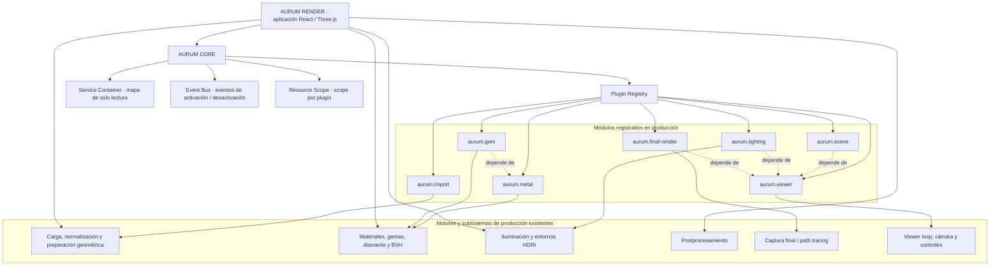

# AURUM RENDER — arquitectura, capacidades y evolución modular

> Estado del documento: auditoría de arquitectura y propuesta de evolución.
> Base revisada: rama `main`, código de AURUM RENDER y dependencias declaradas en `package.json`.
> Propósito: explicar cómo está construido AURUM RENDER, separar capacidades implementadas de capacidades experimentales y definir una evolución modular sin alterar la calidad visual actual.

## 1. Resumen ejecutivo

AURUM RENDER está construido sobre **Three.js y WebGL**. Sobre esa base se ha desarrollado una capa propia especializada en visualización de joyería: materiales de metales, perfiles ópticos de gemas, entornos HDRI diferenciados, preparación de modelos, aceleración geométrica, iluminación de estudio, postprocesamiento y captura final.

Por tanto, la descripción más precisa no es «un motor gráfico escrito desde cero», sino:

**Un motor de visualización de joyería desarrollado por AURUM sobre Three.js, con módulos, perfiles, algoritmos y pipelines especializados propios.**

La estrategia aprobada es conservar esa base y evolucionarla hacia una arquitectura modular con contratos explícitos y plugins. La modularización no debe cambiar por sí misma los shaders, calibraciones, HDRI, geometría ni el resultado visual.

## 2. Comparación tecnológica

La columna de iJewel resume la referencia comparativa compartida para este proyecto. Sus detalles internos no se consideran verificados de forma independiente; iJewel es una tecnología propietaria y no tenemos acceso a su implementación privada.

| Tecnología / capacidad | iJewel (referencia compartida) | AURUM RENDER (estado comprobado en el repositorio) |
|---|---|---|
| Base gráfica | Three.js | Three.js `0.185.1` |
| Arquitectura | Threepipe + WebGi, según la referencia | Motor propio de aplicación sobre Three.js, organizado en componentes y módulos especializados |
| Renderizado | WebGL | WebGL mediante Three.js; pipeline de render en vivo y ruta de captura final |
| Materiales | PBR y plugins especializados | `MeshPhysicalMaterial` y motor PBR propio en `aurum-material-engine.ts`, con perfiles de materiales |
| Diamantes | Algoritmos y shaders especializados (según referencia) | Shader de gemas, dispersión dinámica, perfiles y runtime BVH dedicado; pipeline geométrico de rayos en fase de desarrollo |
| Refracción | Cálculo especializado en tiempo real (según referencia) | IOR, transmisión y respuesta de material de Three.js, más utilidades geométricas propias de refracción/reflexión |
| Piedras preciosas | Pipeline especializado | Catálogo y perfiles ópticos por familia, shader dinámico y entorno de gemas independiente |
| Metales | PBR, tone mapping y LUT (según referencia) | Perfiles PBR propios, motor de materiales y entorno HDRI independiente para metales |
| Iluminación | HDRI de estudio y presets (según referencia) | Controlador de iluminación, presets y entornos separados para metales y gemas |
| Postprocesado | Plugins de SSAO, Bloom, LUT, TAA y otros (según referencia) | Pipeline propio de postprocesamiento y configuración de efectos; la activación depende del modo de render |
| Modelos | 3DM, FBX, STL, OBJ, GLTF y GLB (según referencia) | Pipeline propio de carga y preparación; conversión/exportación GLB y compresión Draco. Los formatos concretos admitidos deben confirmarse por cada ruta del loader |
| Optimización | Render progresivo y gestión de recursos (según referencia) | BVH, cachés, preparación/LOD de geometría, presupuesto adaptativo por triángulos y control del ciclo de vida del visor |
| Captura final | No especificado en la referencia | Ruta de captura final con `three-gpu-pathtracer` y utilidades propias de captura |
| Integración de joyería | No especificado en la referencia | Reconocimiento de partes/capas, asignación de metales y gemas, preparación de mallas y herramientas de exportación |

**Importante:** esta tabla no es un benchmark de calidad ni una certificación de equivalencia. Compara el alcance descrito en la referencia aportada con capacidades y archivos identificados en el repositorio. Para afirmar superioridad o igualdad hacen falta pruebas controladas con la misma geometría, cámara, iluminación, materiales, resolución y hardware.

## 3. Arquitectura actual identificada

### Aplicación e integración

- `src/components/AurumRender.tsx`: componente de integración principal. Coordina interfaz, estado, carga de modelos, selección, materiales, gemas, iluminación, exportación y conexión con los módulos.
- `src/components/AurumRenderShell.tsx`: contenedor/carga de la experiencia.
- `src/components/AurumRenderSidebar.tsx` y `AurumRenderConfig.tsx`: superficies de interfaz y configuración.
- `src/lib/aurum/api.ts`: fachada de comandos para la integración interna y una API allowlisted para configuradores embebidos.

**Hallazgo arquitectónico:** el componente principal tiene aproximadamente 4.900 líneas y concentra demasiadas responsabilidades. Además, actualmente utiliza una directiva `@ts-nocheck`. Esto no invalida el motor, pero sí aumenta el coste y el riesgo de evolución. La solución será extraer responsabilidades gradualmente, con tipos y pruebas, sin reescritura masiva.

### Materiales, gemas y óptica

- `src/lib/aurum-material-engine.ts`: motor de perfiles de materiales para metales y gemas.
- `src/lib/aurum/material-application.ts`: aplica materiales y gemas a objetivos/modelos.
- `src/lib/aurum/scintillation.ts`: respuesta dinámica de gemas y calidad de shader.
- `src/lib/aurum/gem-physical-core.ts`: modelo físico/perfil de gema y campos asociados.
- `src/lib/aurum/optical-response.ts`: respuesta óptica de familia.
- `src/lib/aurum/aurum-diamond-material.ts`: integración del material de diamante.
- `src/lib/aurum/aurum-diamond-pipeline.ts`: utilidades de Fresnel, reflexión, refracción y trazado geométrico de rayos de diagnóstico.
- `src/lib/aurum/aurum-diamond-bvh-runtime.ts`: runtime BVH especializado para gemas/diamantes.

**Límite técnico que debe comunicarse con precisión:** el trazado geométrico CPU de `aurum-diamond-pipeline.ts` es una herramienta de muestreo/diagnóstico; no es por sí solo un path tracer de imagen completa. La captura final dispone de una ruta separada con `three-gpu-pathtracer`.

### Iluminación, escena y renderizado

- `src/lib/aurum/lighting.ts`: controlador de luces y rigs de iluminación.
- `src/lib/aurum/environment.ts`: entorno de metales/escena.
- `src/lib/aurum/gem-environment.ts`: entorno específico de gemas.
- `src/lib/aurum/scene.ts`: controlador de escena.
- `src/lib/aurum/viewer.ts`: creación, resize, ciclo de render y disposición del visor.
- `src/lib/aurum/post.ts`: utilidades del pipeline de postprocesamiento.
- `src/lib/aurum/path-traced-capture.ts` y `path-tracer-final.ts`: ruta de captura final/path tracing.

### Geometría, carga y rendimiento

- `model-loader.ts`, `model-prep.ts`, `model-normalizer.ts`, `model-parts.ts` y `mesh-preflight.ts`: carga, normalización, preparación, identificación de partes y diagnóstico de mallas.
- `live-geometry-lod.ts`: preparación y calidad de geometría en vivo.
- `runtime-budget.ts`: presupuesto adaptativo en función del número de triángulos.
- `thickness-map.ts`: mapas/cachés de espesor.
- `draco-export.ts`: compresión de exportación GLB con Draco.

## 4. Arquitectura objetivo: AURUM CORE + módulos + plugins

La propuesta no consiste en convertir cada archivo en un plugin. Primero se separan responsabilidades y se definen contratos. Algunos componentes seguirán siendo servicios internos del núcleo; los plugins serán extensiones que implementen un contrato estable.

### AURUM CORE

Responsabilidades centrales:

1. Ciclo de vida de la aplicación de render.
2. Contexto de escena y cámara.
3. Acceso controlado al renderer/WebGL.
4. Gestión y liberación de recursos GPU.
5. Eventos de resize, visibilidad y recuperación de contexto.
6. Presupuesto global de rendimiento.
7. Registro y coordinación de capacidades.

El núcleo debe poder iniciar una escena básica y cerrarse correctamente sin que ningún plugin opcional esté instalado.

### Módulos especializados

| Módulo objetivo | Responsabilidad | Base existente |
|---|---|---|
| Gem Engine | Materiales, familias de gemas, perfiles, inclusiones y respuesta dinámica | `material-application.ts`, `scintillation.ts`, `gem-physical-core.ts`, catálogos |
| Diamond Engine | Material de diamante, aceleración BVH y diagnóstico óptico | `aurum-diamond-material.ts`, `aurum-diamond-bvh-runtime.ts`, `aurum-diamond-pipeline.ts` |
| Metal Engine | Perfiles y aplicación de materiales metálicos | `aurum-material-engine.ts`, `material-application.ts` |
| Light Engine | Rig, presets, HDRI y entornos | `lighting.ts`, `environment.ts`, `gem-environment.ts` |
| Geometry Engine | Importación, preflight, normalización, partes y LOD | `model-loader.ts`, `model-prep.ts`, `mesh-preflight.ts`, `live-geometry-lod.ts` |
| Post Engine | Efectos, calidad y composición de imagen | `post.ts`, `aurum-post-engine.ts`, `aurum-ssao-engine.ts` |
| Capture Pipeline | Captura de alta calidad y path tracing | `path-traced-capture.ts`, `path-tracer-final.ts` |
| Pipeline Manager | Coordinar orden, dependencias, perfiles y calidad | Nuevo componente por diseñar |
| Surface Engine | Diagnóstico de costuras y continuidad entre cuerpos | `surface-engine.ts` (diagnóstico experimental de solo lectura) |
| Import Pipeline | Decodificación, conversión GLB, normalización e inspección | `core/import-plugin.ts`, `core/import-pipeline-manager.ts`, `core/geometry-engine.ts` |

### Módulos de importación y continuidad de superficies (estado actual)

La capa de importación ya tiene contratos y orquestación separados del componente visual:

| Módulo | Implementación | Estado real |
|---|---|---|
| Import Plugin | `src/lib/aurum/core/import-plugin.ts` | Implementado; decodifica formatos y delega en el loader/normalizador existentes |
| Import Pipeline Manager | `src/lib/aurum/core/import-pipeline-manager.ts` | Implementado; ordena etapas y solicita inspección geométrica completa |
| Geometry Engine | `src/lib/aurum/core/geometry-engine.ts` | Implementado; inspección de mallas, posiciones, normales y bounds, sin mutación |
| Surface Engine | `src/lib/aurum/core/surface-engine.ts` | Diagnóstico experimental; detecta aristas de borde coincidentes entre cuerpos, sin soldar ni modificar el modelo |
| GLB conversion | `convertAurumToGlb` en `model-loader.ts` | Integrada en la ruta de importación para entradas distintas de GLB |
| GLB normalization | `model-normalizer.ts` | Integrada; reabre el GLB convertido y recupera metadatos Rhino desde el propio GLB |

**Límite importante de AURUM SURFACE:** la primera versión es deliberadamente de solo lectura y no está conectada como transformación automática del GLB. Identifica aristas coincidentes entre cuerpos separados para localizar posibles costuras; no demuestra por sí sola continuidad tangencial G1/G2 ni convierte sólidos Rhino en una superficie NURBS única. La tolerancia debe ajustarse a las unidades y escala del modelo. No se deben fusionar cuerpos ni recalcular normales de forma global, especialmente en gemas facetadas.

La siguiente fase de AURUM SURFACE deberá contrastar estos diagnósticos con modelos 3DM reales y comparar el GLB final reabierto. Solo después se podrá diseñar una reparación selectiva, con conservación de mallas/materiales y fallback al GLB original cuando la validación no sea satisfactoria.

### Contrato mínimo de plugin (diseño propuesto)

Todo plugin deberá declarar:

- Identificador y versión.
- Capacidades que proporciona.
- Dependencias obligatorias y opcionales.
- Inicialización con un contexto explícito.
- Activación/desactivación.
- Liberación idempotente de recursos.
- Configuración validada y tipada.
- Compatibilidad con los modos interactivo y final.
- Pruebas de contrato y de regresión.

Los plugins no deben crear render loops paralelos, apropiarse del renderer sin autorización ni modificar recursos que no les pertenecen.

## 5. Secuencia de implementación aprobada

1. **Baseline visual y de rendimiento:** guardar escena, modelo, cámara, presets, capturas y métricas de referencia.
2. **Contratos de AURUM CORE:** tipar contexto, capacidades, eventos y gestión de recursos. Sin tocar shaders ni calibraciones.
3. **Extraer infraestructura:** separar ciclo de vida del renderer, escena/cámara y recursos.
4. **Gem Engine:** primera extracción especializada, manteniendo la salida visual.
5. **Metal Engine y Light Engine:** separación progresiva con pruebas de equivalencia.
6. **Pipeline Manager:** orquestar módulos y presupuestos de calidad/GPU.
7. **Plugin Registry:** habilitar extensiones internas cuando los contratos estén probados.

## 6. Criterios de aceptación y protección visual

La imagen de referencia de la joya compartida por el usuario será la referencia visual de regresión. Para cada extracción se debe comparar:

- Color, reflejos y respuesta del oro blanco.
- Transparencia, fuego y reflejos del diamante central.
- Apariencia de piedras laterales.
- Legibilidad de engastes y geometría.
- Resultado de captura final.
- Fluidez del orbitado y estabilidad tras resize/minimizar/maximizar.
- Tiempo de render y uso de memoria/GPU, en el mismo hardware y condiciones.

Una extracción no se acepta solo porque compile. Debe mantener el comportamiento visual y no introducir regresiones de rendimiento. Si no se dispone de capturas comparables o métricas, el resultado se marca como pendiente de validación.

## 7. Reglas de ingeniería

- Trabajar exclusivamente en `main`; no crear ramas.
- No reemplazar Three.js ni reescribir AURUM RENDER.
- No modificar shaders, BVH, HDRI ni calibraciones durante las extracciones de infraestructura, salvo autorización técnica explícita y prueba específica.
- Mantener interfaces explícitas y evitar nuevos `any` en los contratos.
- Cada cambio debe incluir pruebas unitarias/de contrato cuando corresponda.
- Ejecutar build, typecheck, lint y pruebas de regresión antes de declarar una fase terminada.
- Preparar SQL separado para carga manual en Supabase si una fase futura requiere cambios de base de datos.
- Mantener AURUM CAUSTICS como laboratorio experimental hasta validar un método físico de cálculo de caústicas.

## 8. Estado y límites de esta auditoría

Esta auditoría se basa en la estructura y los archivos consultados en GitHub. Identifica responsabilidades, dependencias directas y oportunidades de modularización, pero no equivale a un perfilado de GPU ni a una ejecución local de build/tests.

La tabla de iJewel procede de la referencia compartida por el usuario y no constituye una auditoría de su código privado.

**Objetivo:** que AURUM evolucione hacia una plataforma propia de tecnología de renderizado para joyería, conservando la calidad de imagen actual y ganando modularidad, mantenibilidad y capacidad de extensión.

---

## 9. Mapa de arquitectura modular — estado real en `main`

**Corte de auditoría:** 12 de noviembre de 2026. Esta sección refleja los contratos y registros encontrados en el código; no confunde registro con propiedad independiente de recursos.

### 9.1 Diagrama de composición actual

Las líneas continuas indican composición o acceso; las líneas punteadas indican dependencias declaradas en el registro. El diagrama no implica que todos los subsistemas internos sean plugins independientes.

### 9.2 Estado comprobado de los módulos

| ID / capacidad | Estado en código | Qué significa realmente |
|---|---|---|
| `aurum.viewer` | Registrado | Publica referencias de escena, cámara, renderer, controles y host. El adaptador no crea ni dispone esos recursos. |
| `aurum.import` | Registrado | Publica `aurum.import.pipeline`. El pipeline delega en el loader, conversión GLB y normalizador existentes. |
| `aurum.scene` | Registrado | Expone el controlador de escena ya existente; depende de Viewer. |
| `aurum.lighting` | Registrado | Expone servicios del controlador de iluminación existente; depende de Viewer. |
| `aurum.metal` | Registrado | Publica servicios de aplicación/perfiles metálicos mediante el adaptador de materiales. |
| `aurum.gem` | Registrado | Publica servicios de gemas y depende de Metal. No equivale a extraer por completo el motor óptico. |
| `aurum.final-render` | Registrado bajo demanda | Registra un cargador dinámico del adaptador de captura; el adaptador se crea cuando se solicita. |

### 9.3 Infraestructura de AURUM CORE

- **Plugin Registry:** valida identificadores, versiones, dependencias, orden de inicialización y ciclo de vida; realiza rollback si falla el arranque.
- **Service Container:** registra servicios durante la composición y entrega una vista de solo lectura.
- **Event Bus:** comunica eventos del ciclo de vida de plugins, actualmente activación y desactivación.
- **Resource Scope:** crea un scope por plugin y permite registrar limpieza; todavía no hay transferencia general de propiedad de recursos GPU a los plugins.

**Límite importante:** el host administra el ciclo de vida de los plugins, pero los controladores actuales siguen siendo propietarios de sus recursos Three.js/GPU. Por eso, Resource Scope no debe dibujarse como si ya gestionara automáticamente renderer, escena, luces, materiales, HDRI o BVH.

### 9.4 Motores internos que todavía no son plugins autónomos

Estos subsistemas existen y participan en producción, pero continúan coordinados desde la aplicación/controladores existentes:

- Geometry / Model Preparation: loader, normalizador, preflight, partes, LOD y presupuesto de runtime.
- Optical & Material Engines: perfiles de metal, gemas, diamante, shaders, inclusiones y BVH.
- Environment & Lighting: luces, HDRI de metales y HDRI de gemas.
- Post Engine: composición y efectos de imagen.
- Capture / Path Tracing: captura de alta calidad y ruta final.

La separación de estos subsistemas en el mapa es una descripción funcional, no una afirmación de que ya estén aislados como plugins.

### 9.5 Brechas arquitectónicas confirmadas

1. **Importación:** el módulo está registrado, pero el componente de carga aún invoca la instancia local del importador; el siguiente paso es definir un informe estructurado y consumir el contrato de forma coherente.
2. **Propiedad de recursos:** los scopes existen, pero no se ha completado un modelo de ownership GPU por plugin.
3. **Adaptadores:** Viewer, Scene, Lighting, Metal y Gem publican contratos; algunas capacidades internas todavía se exponen desde servicios compartidos o siguen en la aplicación.
4. **Final Render:** el registro publica un loader bajo demanda; no debe describirse como un motor permanentemente activo.
5. **Tipado del componente principal:** `AurumRender.tsx` conserva `@ts-nocheck`; la modularización no ha eliminado todavía esa deuda.

### 9.6 Próxima secuencia de evolución

1. **IMPORT 1.1 — diagnóstico de importación:** informe de formato, conteos, capas, objetos auxiliares, incidencias y etapas/tiempos disponibles. Solo observación; no cambiar geometría ni materiales automáticamente.
2. **IMPORT 1.2 — clasificación asistida:** sugerir categorías de capa con posibilidad de corrección manual; no inferir materiales por color RGB.
3. **IMPORT 1.3 — asignación revisable:** preparar un resumen de asignaciones antes de aplicar materiales.
4. **Resource Ownership 1.0:** definir contratos explícitos de adquisición/liberación y pruebas de limpieza antes de mover recursos GPU.
5. **Viewer / Scene / Lighting:** profundizar extracción solo cuando los contratos y pruebas de regresión estén listos.
6. **Gem / Metal / Final Render:** separar implementación interna gradualmente, preservando shaders, BVH, HDRI y calibraciones.

### 9.7 Criterio de lectura del mapa

Usar siempre tres estados distintos:

- **Implementado:** existe código funcional para la capacidad.
- **Registrado:** AURUM CORE conoce el módulo y puede iniciar su ciclo de vida.
- **Autónomo:** el módulo tiene contrato, dependencias y propiedad de recursos suficientemente aislados para evolucionar o sustituirse sin acoplamiento indebido.

Un módulo puede estar implementado y registrado sin ser todavía autónomo ni instalable de forma independiente.

## 10. Guía operativa: qué módulo tocar según el problema

Esta guía complementa el mapa visual de Herramientas. La ruta indicada es el primer punto de inspección, no una autorización para modificar directamente el adaptador. Los adaptadores publican contratos; el trabajo real puede seguir perteneciendo a controladores y motores existentes.

| Módulo | Responsabilidad comprobada | Cuándo investigarlo primero | Archivos principales |
|---|---|---|---|
| Plugin Registry | Registra plugins, valida dependencias y administra inicialización, rollback y cierre. | Alta/baja de plugins, orden de arranque o errores del ciclo de vida. | `src/lib/aurum/core/plugin-registry.ts` |
| Service Container | Registra servicios durante la composición y entrega una vista sellada de solo lectura. | Un módulo no encuentra un servicio o cambia el contrato compartido. | `src/lib/aurum/core/service-container.ts` |
| Event Bus | Publica y distribuye eventos de ciclo de vida; hoy activación y desactivación. | Eventos no recibidos, listeners duplicados o limpieza de suscripciones. | `src/lib/aurum/core/context.ts` |
| Resource Scope | Agrupa disposers/limpieza por plugin. No posee automáticamente recursos GPU. | Fugas de listeners o recursos que no se liberan al cerrar un plugin. | `src/lib/aurum/core/context.ts` |
| Viewer Adapter | Expone referencias al renderer, cámara, controles y host; no crea ni dispone esos recursos. | Contrato de acceso al visor. | `src/lib/aurum/core/viewer-adapter.ts` |
| Scene Adapter | Expone el controlador de escena existente. | Composición y acceso al controlador de escena. | `src/lib/aurum/core/scene-adapter.ts`, `src/lib/aurum/scene.ts` |
| Light Engine | Acceso al controlador de iluminación, luces, rigs y entornos. | Luces, presets, HDRI o entorno de metales/gemas. | `src/lib/aurum/core/lighting-adapter.ts`, `lighting.ts`, `environment.ts`, `gem-environment.ts` |
| Metal Engine | Delegación de perfiles/aplicación metálica y respuesta de reflexión; calibración pertenece al motor de materiales. | Material, acabado, reflexión o asignación de metal. | `src/lib/aurum/core/metal-adapter.ts`, `src/lib/aurum-material-engine.ts`, `src/lib/aurum/material-application.ts` |
| Gem Engine | Delegación de perfiles y aplicación de gemas y respuesta óptica especializada. | Selección, asignación, perfiles o respuesta de gema. | `src/lib/aurum/core/gem-adapter.ts`, `material-application.ts`, `scintillation.ts`, `gem-physical-core.ts` |
| AURUM IMPORT | Entrada de formatos y delegación a decodificación, conversión y normalización. | Un formato no carga o el GLB resultante es incorrecto. | `src/lib/aurum/core/import-plugin.ts`, `model-loader.ts`, `model-normalizer.ts` |
| Import Pipeline Manager | Ordena las etapas del pipeline y solicita inspecciones. | Secuencia, coordinación o etapas de importación. | `src/lib/aurum/core/import-pipeline-manager.ts` |
| AURUM GEOMETRY | Inspección de mallas, posiciones, normales y bounds; diagnósticos sin mutación. | Mallas, sólidos, intersecciones o diagnóstico geométrico. | `src/lib/aurum/core/geometry-engine.ts`, `solid-engine.ts`, `intersection-engine.ts`, `broadphase.ts` |
| AURUM EDGE QUALITY | Configuración de antialiasing y calidad de bordes; TAA continúa en el pipeline de postprocesado. | Bordes dentados, ghosting, acumulación o artefactos temporales. | `src/lib/aurum/post.ts`, `src/lib/aurum/aurum-post-engine.ts` |
| AURUM SURFACE | Diagnóstico experimental de aristas coincidentes; no suelda ni repara geometría. | Investigación de costuras y continuidad visual entre cuerpos. | `src/lib/aurum/core/surface-engine.ts` |
| Final Render Adapter | Publica captura final bajo demanda y delega en la ruta especializada. | Captura final, path tracing o calidad de exportación de imagen. | `src/lib/aurum/core/final-render-adapter.ts`, `path-traced-capture.ts`, `path-tracer-final.ts` |

### Cómo usar esta guía sin introducir regresiones

1. Identificar el síntoma y localizar el módulo responsable en la tabla.
2. Leer el adaptador y el motor/controlador al que delega antes de editar.
3. Confirmar si el cambio afecta recursos compartidos, GPU, shaders, BVH, HDRI o calibraciones.
4. Añadir o actualizar una prueba del contrato/comportamiento afectado.
5. Ejecutar typecheck, lint, build y pruebas pertinentes; si CI no ejecuta jobs, marcar la validación como pendiente.
6. Comparar una escena de referencia y medir la interacción antes de aceptar el cambio.

**Regla:** no editar `AurumRender.tsx` por defecto. Es el host de integración y aún concentra responsabilidades; primero determinar si el comportamiento pertenece a un adaptador o motor especializado.
